# ZazenCodes YouTube - Season 3

Source code for my Season 3 YouTube videos.

If you landed here from GitHub, the easiest way to use this repo is:

1. Find the video you want below.
2. Watch the YouTube walkthrough for the full explanation.
3. Open the matching folder in [`src/`](src/) to explore the code.

You can also learn more at [zazencodes.com](https://zazencodes.com/) and get a weekly update when I publish at [zazencodes.com/newsletter](https://zazencodes.com/newsletter).

## Video Index

These are the Season 3 source folders currently in this repo. The published videos below are listed in verified order based on the matching entries in my content library.

| Video | Watch | Source code |
| --- | --- | --- |
| [Jev Image & Object Detection Python Demo](https://youtu.be/tqE-96tal4g) | [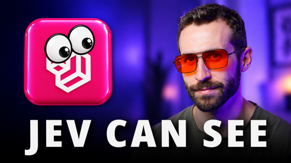](https://youtu.be/tqE-96tal4g) | [`src/jev-box-and-image`](src/jev-box-and-image) |
| [Run your Pi Agent for Free with 9Router + VPS (Full Guide + Demo)](https://youtu.be/OrG6Tya_WhU) |  | |
| [Build an Agent with eve (Vercel's Open Agent Framework)](https://youtu.be/MObkrCUCrJw) | [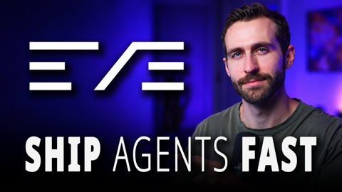](https://youtu.be/MObkrCUCrJw) | [`src/eve-pocket-research`](src/eve-pocket-research) |
| [Build Your Own AI Software Factory with Claude Code](https://youtu.be/ctoaIC4LHmI) | [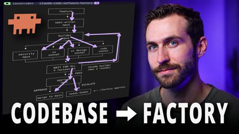](https://youtu.be/ctoaIC4LHmI) | [`src/software-factory-claude-code`](src/software-factory-claude-code) |
| [Build an AI Agent with Neon (One Backend for Everything)](https://youtu.be/ScRzowDz22A) | [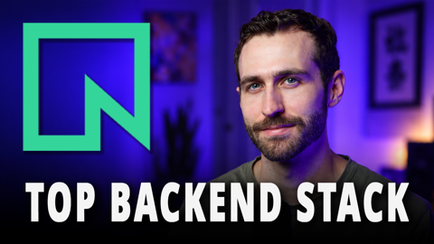](https://youtu.be/ScRzowDz22A) | [`src/neon-notes-app`](src/neon-notes-app) |
| [Understand Jev (the only video you need)](https://youtu.be/EAh1h1GYxDM) |  | [`src/jev-system-one-model-python-demo`](src/jev-system-one-model-python-demo) |
| [How to Build MCP Apps with UI (Skybridge + Alpic)](https://youtu.be/lZBm7tZgvRA) | [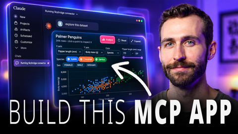](https://youtu.be/lZBm7tZgvRA) | [`src/skybridge-dataset-visualizer`](src/skybridge-dataset-visualizer) |
| [Build a Cyberpunk Coding Game with Kimi K3](https://youtu.be/PfXwEcq6fGA) | [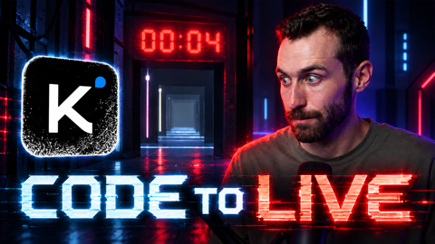](https://youtu.be/PfXwEcq6fGA) | [`src/cyberpunk-coding-game-kimi-k3`](src/cyberpunk-coding-game-kimi-k3) |
| [How to Use Hetzner's Free LLM Inference API with Python & OpenCode](https://youtu.be/OSuI3Iy68KQ) | [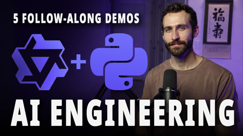](https://youtu.be/OSuI3Iy68KQ) | [`src/hetzner-experiments-demo`](src/hetzner-experiments-demo) |
| [I Built an Agentic RPG with MiniMax + Pi](https://youtu.be/sli6ZbEO13k) |  | [`src/minimax-dev-rpg`](src/minimax-dev-rpg) |
| [How to Build a Serverless AI Agent with Pi](https://youtu.be/EEoMnEcXltk) |  | [`src/bookkeeping-agent/cloud`](src/bookkeeping-agent/cloud) |
| [Build an AI Bookkeeper with Pi Agent Harness](https://youtu.be/Khfiy1lwGPs) | [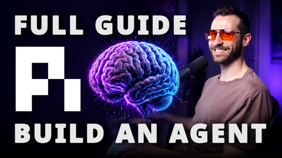](https://youtu.be/Khfiy1lwGPs) | [`src/bookkeeping-agent`](src/bookkeeping-agent) |
| [Build your own Developer Tools with Claude Code](https://youtu.be/4Rx134HkTWw) |  | [`src/claude-code-devtool-kanban-board`](src/claude-code-devtool-kanban-board) |
| [How Software Engineers Actually Use Coding Agents in 2026](https://youtu.be/2HtqFVLgjLI) | [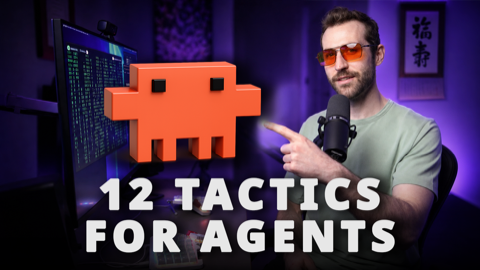](https://youtu.be/2HtqFVLgjLI) | [`src/software-engineers-using-coding-agents`](src/software-engineers-using-coding-agents) |
| [How to Build a Literature Review Agent Skill](https://youtu.be/blz6JoDMyIw) | [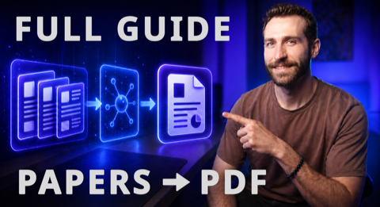](https://youtu.be/blz6JoDMyIw) | [`src/literature-review-consensus-mcp`](src/literature-review-consensus-mcp) |
| [Cross-Platform Agent Skills Guide: Claude Code, Codex, Cursor & Copilot](https://youtu.be/Sl2NilOq9gw) | [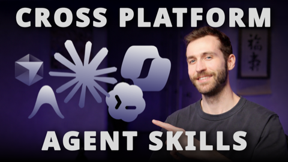](https://youtu.be/Sl2NilOq9gw) | [`src/cross-platform-agent-skills`](src/cross-platform-agent-skills) |
| [Gemma 4 Local Guide: Ollama + llama.cpp on MacBook Pro M4](https://youtu.be/0vvlZjOw0wM) |  | [`src/gemma-4-local-guide`](src/gemma-4-local-guide) |
| [Google AI Studio + Firebase: Build & Deploy a Full-Stack App](https://youtu.be/30iQsttzBps) | [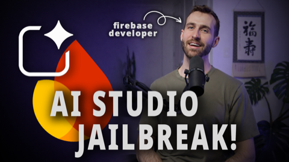](https://youtu.be/30iQsttzBps) | [`src/google-ai-studio-firebase`](src/google-ai-studio-firebase) |
| [The best way to create agent skills in 2026](https://youtu.be/XCOkCwgKwAA) |  | [`src/dry-run-workflow-for-agent-skills`](src/dry-run-workflow-for-agent-skills) |
| [Stop using AGENTS.md and CLAUDE.md (do this instead)](https://youtu.be/myCRW_u6U2U) |  | [`src/agent-md-effectiveness`](src/agent-md-effectiveness) |
